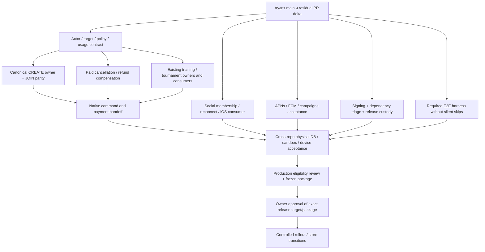

# LK2 R1 — зависимости и критический путь

## Актуальный критический путь — 2026-11-01

1. SOURCE/CI: station LK287+CUP73→LK2545 завершён; tournament CUP74→LK2546→MESSAGE547 завершён. Exact heads/runs: [READINESS](R1-READINESS.md).
2. Подготовлена обновлённая локальная batch A: base547 `0869bc3baa49679ffa1702cc8ae5f37e149adab3` +545 `a81b774b660764079c5e9b74c41a4f841f263696` +536 `63bd45ffc1abe9a192a2164c83b23d47181dbaee` +539 `1de0ef602708a4413f2ea99cd3b21d8b88fd0cbd`. Все fullCI green; новый exact approval запрошен, выполнение не начиналось.117 migration paths, общие blobs одинаковы; это не SQL apply или combined acceptance.
3. После общего green integration head — отдельная партия с native542, затем native tournament Stage B. Не копировать конфликтующие App/gateway файлы для обхода integration approval. Прежние pending предложения A/B ниже исторические; разрешения525/528 не распространяются на новые heads.
4. Параллельно CUP74 causal baseline→tournament readonly owner feed + canonical background identity resolver (в работе)→durable tournament importer/outbox/dispatch (ещё не реализованы).
5. Attributable monetary settlement — отдельная BLOCKED зависимость. Затем полный non-sending E2E и отдельно разрешённые provider/device/signing/release transitions. Ни source integration, ни CI не снимают live gates.

## Предыдущая контрольная точка source/CI — 2026-11-01

Критический путь исходников: (1) ordinary FCM/Web pre-dispatch policy#544 на525, SOURCE/LOCAL/review готовы, CI41285469025 SUCCESS (новыеPG17/17); (2) station owner feed → канонические получатели/current-epoch ACL → durable LK2 import/outbox → dispatch ACL и recovery; (3) аналогичный tournament bridge. Эти SOURCE gaps должны быть закрыты до device/provider acceptance.

Параллельная social ветка: owner285/72 → Web541 → native542 (full/iOS CI SUCCESS); CUP71 → API/Web543 (full/iOS CI SUCCESS) → согласованная интеграция542/543 → tournament native Stage B. Native consumer не создаётся копированием конфликтующих App/gateway файлов.

Новая локальная batch A ожидает точного ответа владельца: `integration/r1-core-social-source-20261101`, base541e38dd886 +525f042389b +53663bd45ff +5391de0ef60. Эта партия не включает542/543 и не выполнялась. Ранее разрешённые #525/#528 завершены; их разрешение не переносится на новую партию. Merge в main, publication и live gates остаются отдельными.

Новая local batch B ожидает точного разрешения: base542c6a03c21 +54389b4c7b9 → `integration/r1-social-clients-source-20261101`, только два shared Web файла требуют согласования. Оба head full/iOS green; после coherent integration следует native tournament Stage B. Batch B не включает A или544 и не выполнялась.

Перед managed SELF activation включить286 поверх283; partial daily-only installation недостаточна, нужен canonical guard и остановка старых исполнений. SOURCE-защита pending не заменяет attributable per-booking credit. Station notification owner feed находится в реализации; downstream importer/current-ACL/worker floor остаются незакрыты.

Station notification feed: локально подготовлены 15 файлов и 54 unit/contract cases, отдельные 2 release-packaging tests PASS; 6 физических Mongo cases пока CI-only. Независимое review нашло P0 в зависимости CUP#72 `6a6301197cecbc90cb6ba37f55c520f3d39564c1`: STATION→FRIENDS→REMOVE/APPROVE→STATION сохраняет старый membership epoch и может снова разрешить старого получателя. Feed не считается готовым. Исправление CUP должно запретить type flip после adoption и атомарно закрыть гонку type update/adoption; уже несогласованное состояние не ремонтировать автоматически. Затем нужны повторное review и physical CI. Downstream LK2 import/outbox/dispatch ACL ещё не реализованы.

## Предыдущая контрольная точка — 2026-11-01

Актуальная social цепь: LK#282 → LK#285 ↔ CUP#72 → LK2#540 → #541 → native v3; CUP#64 → #70 ↔ LK2#539 → CUP#71 → LK2 tournament API/Web → native. Затем совместимый integration source → отдельные runtime/store gates. #285/#72/#71/#541 имеют полный CI SUCCESS; у#541 также зелёный unsigned iOS CI. Эта зависимость не разрешает merge, adoption, установку ключей или deploy.

Владелец разрешил обе точные локальные интеграции; они выполнены и отправлены в свои Draft PR. [#525](https://github.com/Z6v6e6r/lk2/pull/525) `f042389bb09703a75b502e793b28985028cc1f54` включает согласованные #52630598d97 (с #524) и #523f5c33149. LOCAL302 функциональных и22 delivery-contract проверки,54 изменённых TS файла с зависимостями:0 diagnostics. Guard suite:48PASS и один отдельно повторённый PASS после временной ошибки разбора Darwin ps; это составное evidence, не полный повтор49. Android41274690263 SUCCESS:16 обязательных JVM cases, unsigned release APK artifact13070946919 (ZIP SHA256 `207921dd54feadf82e42ff3e84750617a412a0c9ee1692ab6ba70af591facbd6`, expires2026-11-15). iOS41274690260 SUCCESS:30PASS/1app-hosted Keychain SKIP и unsigned simulator build; full41274690282 SUCCESS:7555PASS/126SKIP; SELF PG9, managedJOIN PG3, TRAINING PG6, closedPG4. Required35physical+8guards zeroSKIP (lifecycle13/comms10/Rabbit4/notificationPG4/notificationRabbit4); static/security/deployment и все пять Docker builds PASS. Независимое review и exact outgoing scans PASS.

[#528](https://github.com/Z6v6e6r/lk2/pull/528) `cd4b3d27b156b56923fb0a96dfadad8f9b92b19f` содержит разрешённый parent#5273143ffbe. Итоговое дерево `9dd1d57c2a087d1a418a31bd92f6437cfc04bfeb` побайтно совпадает с прежним26c5ceaa: TRAINING bundle сохранён, исправление JOIN fixture уже присутствовало. Предыдущие54 LOCAL проверки переиспользованы; merge-custody review и outgoing scan PASS. Конфликт снят. Initial fullCI41274959565:7546PASS/126SKIP, TRAINING PG11 и managedJOIN PG10 PASS; один устаревший current-inventory testFAIL. Test-only `fbf29562bd5f359031f1ff6cda0be7b4ed4e712d` меняет только +9→+10 и список с0108, frozen ledger и rejection сохраняются. LOCAL1PASS/27 name-filteredSKIP, review/scans PASS; corrected fullCI41275879957 SUCCESS наfbf29562:7547PASS/126SKIP, TRAINING PG11/11, managedJOIN PG10/10, closedPG4/4, required27physical+8guards zeroSKIP; static/security и все пять Docker builds PASS. Прежние сообщения об ожидающих разрешениях или заблокированном запуске CI ниже являются историческими.

Правило турнирного чата реализовано отдельным SOURCE/CI пакетом: явное назначение профиля в [LK2#539](https://github.com/Z6v6e6r/lk2/pull/539) `1de0ef602708a4413f2ea99cd3b21d8b88fd0cbd` и [CUP#70](https://github.com/Z6v6e6r/ph-admin/pull/70) `5291e2aba00869f0fb543fea982232353b208753`. Full CI41277973675 и CI41278160399 SUCCESS, включая новые PostgreSQL3 и Mongo8 physical cases. Dedicated readonly lookup, tenant/station authorization, revision CAS, постоянный original receipt и GET-only восстановление прошли независимое review. Исправлены позднее открытие редактора после logout и приём невозможного revision receipt. Конфигурация отключена; ключи не создавались. Это **не** реализация tournament chat send/read/realtime ACL.

Native station consumer [LK2#540](https://github.com/Z6v6e6r/lk2/pull/540) `ce1b9249f0a824ce01a8136776f7f372b0469143`: full CI41278040418 и iOS41278040429 SUCCESS. Android shared UI и отдельный iOS entry используют исходный UUID; при pending native ручной Send и reload выполняют только GET. LOCAL/review/secret-PII scans прошли. Детальные counts и ограничения — в [R1-READINESS.md](R1-READINESS.md). Exact unread/gap-free catch-up реализованы в новых source-пакетах выше; native adoption, source integration и device acceptance остаются открыты. Все три PR — Draft, без main merge или live activation.

[#538](https://github.com/Z6v6e6r/lk2/pull/538) `0dfc0458879a7ed1eece423713bbbce215ab4046`: bounded NO_PAYMENT organizer CANCEL реализован для Web/Android/iOS с серверной canonical capability, original-principal fence на SDK retry и GET-only восстановлением неоднозначного результата. LOCAL/review/scans прошли; unsigned iOS41274254446 SUCCESS, static и пять Docker builds PASS. Full41274254490:unit7872PASS/127SKIP и closedPG4PASS; required physical gate остановился на новом fixture: started case нарушал существующий SQL constraint join_cutoff_at<=starts_at. Test-only `7faff1b698d0424c284a41754445fcdb6866fac4` исправляет согласованность fixture timestamps/cancellation metadata, assertions неизменны; LOCAL6PASS/14CI-onlySKIP/typeslint0, independent review/scans PASS. Corrected full41275758102 и iOS41275758096 SUCCESS на7faff1b6:7872PASS/127SKIP, quarterPG12/closedPG4, required28physical+8guards zeroSKIP, включая новую capability fixture; static/security и все пять Docker builds PASS. Native local CANCEL SOURCE/CI завершён; устройство/runtime не приняты.

Решение R1 остаётся **NO-GO**. Эти операции — локальные разрешённые merge и task-branch push; новых merge в main, публикаций, deploy, real DB/provider writes, signing/store activation не было. Этот раздел имеет приоритет над более ранними checkpoint ниже.

Денежный provider input перепроверен отдельно от исходной оплаты: LK main608ebe2068, docs/architecture-workspace OpenAPI/contracts/evidence и документальные изменения16 локальных R1-веток не содержат attributable game CURRENCY refund/DEPOSIT credit read schema. `docs/MANAGED_SUBSCRIPTION_SYNTHETIC_CREATE_CANCEL_HAR.md:28–43` перечисляет Swagger booking/options/cancel endpoints, но не refund/credit reader и finality. Annual-subscription draft и `PITER_SUBSCRIPTION_CONTRACT.md` не доказывают game settlement. Это отсутствие evidence в проверенном scope, не утверждение об отсутствии API у Viva. Владелец подтвердил: Viva Swagger больше недоступен. B04 settlement остаётся BLOCKED внешним контрактом/подтверждением; reader semantics не придумываются, cancellation и settlement различаются. Проверка была SOURCE/read-only, без provider/DB вызовов.

## Текущий статус — 2026-11-01: закрытые SOURCE/CI проверки

[LK#283](https://github.com/Z6v6e6r/lk/pull/283) `19e66ee0161f240dceb38853e6a9c6654168f4d3` (runtime784cea38, base#270) закрыл bounded SOURCE/CI защиту monetary SELF dispatch: полный [CI41272659955](https://github.com/Z6v6e6r/lk/actions/runs/41272659955) и [Mongo41272659903](https://github.com/Z6v6e6r/lk/actions/runs/41272659903) SUCCESS. Mongo27/27, включая шесть физических conflict/recovery cases, zeroSKIP; inherited owner28/28 и worker22/22. LOCAL145PASS/6CI-onlySKIP, test-only historical current-source rebind3/3, independent R3 review и staged/outgoing PII/secret scans PASS. Baseline SERVICE и dispatch marker сохраняются до HTTP; ACK-loss и graph observer не дают повторной отправки. Money остаётся UNVERIFIED; crash-before-HTTP может удерживать прежний game-wide gate. Это не settlement/provider/runtime acceptance.

**Release NO-GO; SOURCE/CI и runtime acceptance разделены.** Нативный quarter CREATE [#533](https://github.com/Z6v6e6r/lk2/pull/533) `d57e3e7dde5593f16cf1151587d058d2b8b83e21`: full41264822510 и iOS41264822518 SUCCESS. Quality7748PASS/126SKIP, quarterPG12/12, closedPG4/4, required27physical+8guards zeroSKIP; source/static/dependency/deployment/secret и пять Docker builds прошли. Исправления после runtime2aabc692 затрагивают только тесты: obsolete casts, ожидание bounded quarter route и архивный fixture исторического controller pin. Текущему изменённому blob старый controller по-прежнему отказывает. Android APK/device acceptance не получены.

Web station chat [#535](https://github.com/Z6v6e6r/lk2/pull/535) `de952dc4e882dd3ebf332300c4c9edb81cb97793`: 45 reviewed files, SOURCE/LOCAL verified, initial full41265870441:7802PASS/126SKIP/1FAIL (test ожидал callback до завершения WebCrypto), iOS41265870267 SUCCESS. Test-only2c4becf8a242366fb964eb3da53dd1c48ad11378 усиливает ожидание и custody assertions;8LOCALPASS/typeslint0/review/scans PASS. Corrected full41266782435 и iOS41266782380 SUCCESS:7803PASS/126SKIP,quarterPG12/12,closedPG4/4,required27physical+8guards zeroSKIP; source/static и пять Docker builds PASS. Сервер получает проверенный user-scoped LK Bearer; actor/session/mapping refusals не открывают общий circuit breaker. UUID+hash сохраняются до POST, reload только GET, нет повторного POST/fallback; ACL denial очищает историю, logout закрывает поздний ACK. LOCAL17suites/130PASS плюс изменённые subsets (не суммировать), types/lint/OpenAPI и synthetic390/1280 прошли. Web-only: native composer намеренно недоступен, device/delivery acceptance не заявлены.

Неиспользованный reserve expiry: [CUP#69](https://github.com/Z6v6e6r/ph-admin/pull/69) `e8e16b2dc79c0970f99100ff698affcc2465297d` → [LK#281](https://github.com/Z6v6e6r/lk/pull/281) `70fd376bfd37bed3e69b3ff432cb09381ea2df90` → [LK2#536](https://github.com/Z6v6e6r/lk2/pull/536) `63bd45ffc1abe9a192a2164c83b23d47181dbaee`. 26 reviewed files; LOCAL LK79PASS/7MongoSKIP, legacy114PASS/1SKIP и split29PASS; CUP lifecycle/preflight/readback PASS, physical import types0; LK2 72PASS/20PGSKIP, types/lint0. LK Mongo41266210816 выявил test-only ошибку: после скачка времени fixture повторно использовал истёкший actor JWT; runtime правильно отказал. Test-only7f375a31c427b7c7e820a771ec9b941875b7fad2 сохраняет refusal и проверяет recovery с новым actor proof; LOCAL1PASS/7CI-onlySKIP, review/scans PASS. CUP CI отсутствовал из-за фильтра base branch; CI-only764e809e5a2cb652faf8cdaf81ea3d8557bf7fd9 добавляет ровно базу #67, пять CI guards/review/scans PASS. Исправленный LK Mongo41266536638 SUCCESS:87/87 включая7physical, zeroSKIP; worker22/22. Фактический LK CI использовал mongo:8.0 (проверено по pull/create в логе), а не Mongo7 из предварительного handoff. CUP full41266419414 SUCCESS: реальная replica-set гонка confirm/release в обоих порядках, loser zero mutation, lost ACK/post-TTL; entitlement skipped=0/provider writes=0. LK full41266536635 SUCCESS. LK2 full41266216875 SUCCESS:7755PASS/126SKIP,quarterPG20/20,closedPG4/4,required27physical+8guards zeroSKIP, source/static и пять Docker builds PASS. Полный snapshot и Mongo-clock CAS должны доказать отсутствие dispatch до signed release; ATTEMPTING остаётся UNKNOWN. Сначала canonical RELEASED и исходный schema2 receipt с checksum, затем reclaim. Все staged/outgoing secret scans прошли без исключений; source manifest SHA2563d3cd929f60a5553b0050b2c9d314101200ca54fbd8a4a9e18b22af0a76a7159. Собранный LK2 runtime bundle byte-identical HEAD854147ab, generated файл не менялся.

Station history v2: [LK#282](https://github.com/Z6v6e6r/lk/pull/282) `f6520b031e29db90845bda4b9b56492f2520185f`, full [41268575186](https://github.com/Z6v6e6r/lk/actions/runs/41268575186) и Mongo [41268575195](https://github.com/Z6v6e6r/lk/actions/runs/41268575195) SUCCESS. 20/20 history cases, включая четыре физических Mongo8, zeroSKIP; worker22/22. Guarded graph composer отвергает broad/ambiguous catch/complete observers до добавления приватных read nodes; исходные auth ingress и v1 сохранены. Первое full CI остановилось на синтетическом phone literal в negative fixture; test-only correction проверяет phone-only и foreign-ID с совпадающим телефоном ACTIVE member. Exact configured added-line PII scan и Gitleaks PASS без исключений, runtime/scanner неизменны.

[LK2#537](https://github.com/Z6v6e6r/lk2/pull/537) history head `8651a0db4ccc5362ca9eed0437fb8c89c1179fd3` прошёл full [41267653658](https://github.com/Z6v6e6r/lk2/actions/runs/41267653658) и iOS41267653681:7826PASS/126SKIP,closedPG4/4,required27physical+8guards zeroSKIP,static и пять Docker builds. Actual LK helper fixture SHA256 `50e02af00ef28ad2163f6d7909bd748c3741bbac251da3c4f7581ddce4f0440a` принят реальным LK2 parser. Строгий tuple cursor, duplicate-only continuation и repeated-cursor rejection проверены. Текущий continuation `5f8cf40798129f5d9d591121060ad70dae9e5734` добавляет station first-page GET на online/focus/visible, coalescing, cleanup fence и restart cursor; SOURCE/R3 CLEAR, LOCAL77PASS (Chats69+Composer8), types/lint0. Его full [41269740593](https://github.com/Z6v6e6r/lk2/actions/runs/41269740593) и iOS41269740624 SUCCESS:7835PASS/126SKIP,quarterPG12/12,closedPG4/4,required27physical+8guards zeroSKIP; static/dependency/deployment/secret gates и выбранные Web/API Docker builds PASS.

Исторический gap v2 (новый SOURCE/CI owner285/72 и consumer541 описаны выше; runtime ещё не активирован): прежний owner использует reservedAt как createdTs; поздняя публикация может оказаться позади прочитанного cursor. История COMMITTED может появиться до event proof; CONFIRMED status проверяет оба. Свежая первая страница не является gap-free catch-up. Нужны согласованные owner acceptance sequence, непрерывная подтверждённая граница публикации и current-epoch read marker; timestamp/Date.now и чужой PG last_read_sequence их не заменяют. Никакой такой migration/backfill не выполнен. Полная runtime browser E2E недоступна: repository local:status подтвердил отсутствие reachable local Linux Docker engine; DB/containers не создавались.

Уточнённый путь B07: LK#279 → LK#282 matched v2 owner → LK2#535 → LK2#537 → согласованная native integration → device acceptance. Для точного unread отдельная цепь: same-community sequence+retained publication proof → bounded sync frontier → epoch-bound read marker → counters/reconnect acceptance. Tournament chat: решение organizer principal + CUP#64 current original JOIN generation → acceptance CAS в том же tournament document, конкурирующий с LEAVE → отдельный LK2 hidden candidate storage → atomic message/sequence/outbox publication → current read/realtime ACL → клиенты. JOIN/LEAVE journal512 и moderation hidden_at не являются безопасным pending-message storage. Это зависимости, не разрешение на новые live действия или обход ожидающих #525/#528 integration approvals.

Ни один из новых PR не merged/activated. Production configuration, provider, shared DB, signing и stores не изменялись. Следующие разделы сохраняют историю; при расхождении приоритет у этой контрольной точки.

Дополнение к критическому пути: CUP#67→#69, LK#277→#281, LK2#534→#536. Совместимая установка CUP→LK→LK2; старые binaries отвергают новый reason/receipt. Station chain LK#278/CUP#68→LK#279→LK2#535; #535 stacked на native#533. Интеграция обязана сохранить tournament#530/#531, Web href#532 и Android packaging#526. Отдельные разрешения для локальных #525/#528 остаются ожидающими; новые source PR не обходят эти переходы.

Актуальная station chat source chain: LK#276 + CUP#63 → LK#278 + CUP#68 → **LK#279952031f7 (versioned send/read-only original status, оба CI SUCCESS)** → LK2 authenticated public mapping/consumer/custody → stable pagination/unread/reconnect → Web/native/device acceptance. Новый endpoint устраняет риск старого графа, который мог бы проигнорировать версионный заголовок на прежнем send path; 404 нового endpoint остаётся UNKNOWN.

## Денежная SELF отмена и native local CANCEL

LK#269 → LK#270 → [LK#283](https://github.com/Z6v6e6r/lk/pull/283) добавляет original-booking dispatch fence и durable SERVICE baseline для смешанной очереди. После полного CI нужны согласованная установка графа с drain старых writers и отдельное attributable settlement evidence; cancellation receipt не заменяет финансовый результат. Исходный PAID transaction→booking claim уже существует в LK; отсутствует именно attributable refund/DEPOSIT-credit reader с destination/amount/finality, поэтому не нужен новый generic payment owner. Native organizer CANCEL развивается независимо от денежных refunds: существующий server NO_PAYMENT writer → revision-bound allowedActions.CANCEL → exact Android/iOS consumer → integrated source и device acceptance. Новый recovery API, новая схема и выбор owner по нулевой цене не требуются.

## Актуальный CREATE critical path — 2026-11-01

CUP#65→#66→#67 + LK#273→#277 → LK2#532 Web/API → две независимые ветки от90b2ba2b: **#5332aabc692 native** и **#534fd2f87fd station producer**. Для#534 обязателен LK#276→#280bfacff70 receiver. Source/LOCAL/review обоих companions завершены. Producer#534 full41262584637 SUCCESS (18quarterPG,4closedPG,27physical+8guards zeroSKIP); native#533 iOS41263018206 SUCCESS, final full41263945947 ещё выполняется (test-onlyc69fe2c2 после устаревшего MobileApp route fixture;9affected testsPASS). Parent#53296be6b4d содержит отдельный Web href fix, который сохраняется при интеграции.

После CI: разрешённая интеграция с#530/#531 и#526 без потери их native routes → frozen source/immutable artifacts → отдельно разрешённые миграции/receiver/API/worker installation и drain старых writers → runtime/provider/device acceptance.0111 nullable не делает старые NULL adopted и не обеспечивает writer floor для старого binary; без согласованной установки нельзя активировать producer. Подтверждённая новая booking generation может вернуть LEFT, replay старой — нет; REMOVED/BANNED не возвращаются автоматически.

Отдельная ветвь P0 — reserve-only expiry: canonical CAS должен победить CREATE attempt до signed release/readback. ATTEMPTING нельзя освобождать по отсутствию provider ответа. Этот контракт ещё не реализован; подготовка source не разрешает денежный release или live mutation.

## Актуальная цепочка сообщений станции — 2026-11-01

- LK#275 → LK#276 `62e32f7b` → LK#278 `0de4cf4b`.
- CUP#63 `1abc9150` → CUP#68 `16fa3e5c`.
- LK#278 и CUP#68 требуют согласованной установки: новый обработчик сообщений и административные записи сохраняют один outbox. Оба source/CI green; их merge/установка не выполнены.
- Следующий независимый SOURCE этап: LK2 read/send/status consumer со стабильными идентификаторами, исходным ключом, reconnect и непрочитанными; затем native parity и device/runtime acceptance.
- До любой активации: завершить старые выполняющиеся запросы, подтвердить сохранность receipt/outbox и Mongo durability. Отключение флага не разрешает возврат к старому STATION writer.

Точные ожидающие локальные интеграции #525/#528 остаются отдельными разрешениями; эти новые PR их не обходят.

Ниже сохранены предыдущие контрольные точки; текущие статусы — в разделах выше.

## iOS tournament source checkpoint — 2026-11-01

iOS#53199f5d942 depends on Android#5304406a3b2/API compatibility and Web#5293041f0d9/CUP#64. NativeCI41254366026 passed; fullCI41254366038 SUCCESS (7670passed/126skipped, tournamentPG7/7, required27physical+8guards zeroSKIP). DIRECT/TRAINING native branches are not ancestors and must be integrated once by the authorized integration owner; no silent copy or merge bypass occurred. Real Keychain/process-death and WKWebView capability checks remain separate device gates.

## Paired quarter CREATE source checkpoint — 2026-11-01

Quarter source chain now reaches CUP#65 publication/target → CUP#66 instance adoption → CUP#67 actor-bound v3 intake + LK#277 original CREATE owner. The paired latter source is reviewed and pushed; LK physical Mongo41254002352 and41254342435 passed; corrected full41254342434 SUCCESS. Current LKhead59d3880c is test-only current-hash correction. CUPhead802ed017 fixes only a duplicated synthetic publication key after41253980880; corrected fullCI41254507939 SUCCESS including physical v3 replay. Next: LK2 original draft/operation consumer and canonical importer convergence → explicit CREATE station admission/confirmation → Web/native and provider/device acceptance. Existing JOIN station loader cannot be reused by calling a CREATE receipt JOIN. Canonical LK_LEGACY_SNAPSHOT import ownership must converge with the provider receipt before a public game is claimed.

## Android tournament checkpoint — 2026-11-01

CUP#64 → LK2#5293041f0d9 (fullCI/iOSgreen) → Android#5304406a3b2 (LOCAL/review;CIpending) → approved native build integration#526 and device acceptance. iOS tournament capability is a separate bounded consumer. Android changes overlap pending TRAINING in App/auth-gateway/MobileApp/native-api-fetch/AndroidSessionPolicy; only the approved integration owner resolves them. No existing integration request is bypassed.

## Community message prerequisite — 2026-11-01

Durable LK community message owner/commit receipt → stable authenticated message read contract → LK2 Web/native send and original-key recovery → realtime/unread/reconnect and device acceptance. Existing station membership packets do not supply this message owner. Tournament chat also needs a concrete canonical membership consumer; the database enum alone is insufficient.

## Concrete consumer dependency — 2026-11-01

CUP#64 `9d728414` → LK2#529 `40d450c0` Web/API/0109 consumer (LOCAL/review accepted; corrected-head fullCI41251823614 SUCCESS) → compatible native consumers → coordinated runtime and device acceptance. Migration0109 follows0108 and retains the operation journal on rollback. #529 is based on#528; it supplies no authority or workaround for the pending#528/#525 local integrations. Paid/provider tournament ownership remains a separate prerequisite.

## New bounded P0 paths — 2026-11-01

1. CUP#61 preparation → #62 canonical gender → **#64 LOCAL_ONLY owner (CI41246247607 SUCCESS)** → LK2 authenticated tournament command/read/recovery consumer → native journey and tournament membership acceptance. Provider-backed and monetary paths require separate attributable owner/compensation contracts; do not downgrade them into LOCAL_ONLY.
2. LK#273 nonbinding quarter observation + **CUP#65 publication4/target2 proof (LOCAL and CI41247998877 accepted)** → strict schema4 projector/readiness and bounded FULL_RECONCILIATION → authenticated LK target producer → original-CREATE durable owner/reserve/receipt → LK2 CREATE consumer. Preserve every old instance's purchase-time policy. A new publication clears the reconciliation fence; replaying INITIAL_FULL is not a checkpoint refresh. Existing sale-binding accepts trusted payment readback and is not itself a provider purchase writer.

The quarter descriptor is an approved mapping, not a live provider observation. The full authoritative instance snapshot still requires endpoint/pagination/normalization/payment/identity evidence. Implementing schema4 support does not authorize importing a real snapshot, buying a subscription or changing a flag.

Updated quarter chain: #65 `5812113c` fullCI41247998877 SUCCESS → #66 `5eb4fe04` bounded instance reconciliation (LOCAL/review accepted, CI41248667293 SUCCESS, including full typecheck/build/artifact gates and the actual Mongo reconciliation/race fixture) → authoritative snapshot and authenticated LK producer → durable original-CREATE owner/recovery/receipt → LK2 CREATE. Sale/import concurrency is serialized by the existing projection fence; mixed old writers are not supported and must be drained before activation.

Further SOURCE audit: LK has no approved clientRefHash handoff; CUP computes it from verified identity and intentionally omits it from runtime-context. Current intake UUID-only configured tenant and CUP actor tenantKey are different namespaces. The next coordinated CREATE packet must derive actor/tenant/hash inside a versioned variant of the existing CUP intake, preserve context privacy, and connect it to an actual LK CREATE owner. Existing CREATE prospective target has null base price, old policy gate requires60/90/120, and timeout/409 room-time lookup cannot attribute creation. Pin the original quarter tuple and persist the ID from the original successful provider response; ambiguous creation remains UNKNOWN without a second POST or adoption of a found exercise.

## Station critical path — 2026-11-01

`LK#275 + CUP#63 → LK#276 → LK2#527/#528 physical CI → reviewed0108 migration/signing/coordinated writer package → separately approved runtime/device acceptance`.

LK#275/#276 and CUP#63 CI are green. #527 corrected head3143ffbe has fullCI41244545169 SUCCESS (managedJOIN PG10/10, required27physical+8guards zeroSKIP). #52826c5ceaa is source-reviewed with54 LOCAL cases, but needs exact approved local synchronization with parent3143 before PR CI can start. This is independent of the still-pending local #525 update request; no merge is inferred from a development request. All production transitions remain separately gated.

Training uses authoritative providerStudioId from its verified original capsule and validated receiptId as generation. It does not depend on GAME court-binding0105. Legacy NULL and pre-adoption GAME snapshots stay excluded; no retrofit/backfill. Current subscription training actor/target fence remains until a real training LEAVE/rejoin contract exists.

## Текущий dependency-aware critical path

1. Source-only merge/flag cycle #511 завершён: mainCI41230249442 success, delivery41231241175 SKIPPED/steps=[], true восстановлен18:50:31 UTC; остальные candidates интегрировать только после отдельного exact-head разрешения. Green CI и source merge не разрешают публикацию/deploy.
2. CUP#60 → LK#267 → LK2#515: accepted source/physical CI managed JOIN; отдельная совместная PROVIDER/native acceptance остаётся.
3. LK#269 → LK#270 → LK2#519 → #521: FREE/SERVICE SELF и restrictive terminal non-dispatch recovery. #521currente1d781 CI41234847565/native41234847625 SUCCESS, SELF physicalPG9/9. Затем native/provider acceptance.
4. #517 mapping0105 → LK#273 fixed-quarter preparation (source/CI green) → trusted server producer и versioned actor/draft-bound CUP target/preflight/reserve → original-create owner/receipt → LK2 CREATE. Existing v1/LK1 semantics сохраняются; проверить actual applied1/4 benefit после daily-limit policy. Nonbinding observation/hash не заменяет producer authority или lost-ACK attribution.
5. LK#271 → LK2#5200107 → #524477404e7: Web/API source/CI green, включая6physicalPG; Android catalogue/registration#524477404e7 source/fullCI41237803621/native41237803616 SUCCESS; отдельный #52630598d97 AndroidCI41238685334 подтвердил actual unsignedAPK и16JVM, егоfullCI41238685061 SUCCESS:7411passed/126skipped+PG4/4. Далее device и owner/provider capacity acceptance. CUP-managed/paid/trial/LEAVE отдельны; CREATE не prerequisite этой цепочки.
6. CUP#61 fresh nonbinding owner preparation → CUP#62 authoritative actor gender + MALE/FEMALE check/MIXED unrestricted (source/physicalMongoCI41240145187 green) → exact owner admission/capacity/WAITLIST/original generation → LK2 tournament consumer → tournament chat membership. Нельзя выбрать LK writer по отсутствующей custom link или dual-write CUP/LK roster.
7. LK1 monetary commands уже существуют. Их original-booking/generation/options/CAS/readback → attributable payment/refund/credit evidence → bounded LK2 pending/settled consumer → separately approved financial acceptance. Booking cancellation/REQUESTED не доказывают деньги. Затем solo-organizer cancellation; bulk scope не подразумевается.
8. Одно official community per station + automatic membership после confirmed game/training registration: existing CUP STATION binding + exactly-one selection/write owner → event/generation-fenced membership producer → permission-safe chat/read/unread/native entry. Pending booking не считается вступлением; support chats не заменяют community. CANCEL сохраняет membership; voluntary leave запрещает replay того же факта, новая confirmed registration может вернуть; REMOVED/BANNED не возвращаются автоматически.
9. #516 → #518 synthetic iOS native5/5 уже CI verified; следующий уровень — physical device/real session/push. #522ada66c50 CI41233392220 подтвердил27 ранее skipped game lifecycle/PG/Rabbit physical cases +8guard, zero skips и cleanup только собственных fixtures. #523f5c33149 добавил8notification physical cases, CI41235695070 SUCCESS/zero skips. Общий device/provider E2E gate остаётся.
10. #525eb993ff6 — source integration четырёх frozen green heads #517/#521/#520/#522, LOCAL226 +typed closure passed, integratedCI41236564284 SUCCESS:7497passed/126skipped, frozenPG4/4; #523notification и#524Android companion остаются отдельно. После green exact tree потребуется отдельное source-only merge authority. Затем immutable package → approved staging/provider/device acceptance → signing/store/restore evidence → новое GO/NO-GO → отдельные owner approvals на каждый live transition.

## Исторические схемы и прежние checkpoint

Уточнение B03 после проверки CUP#61/LK#273: готового authoritative dictionary artifact→publication→prospective CREATE producer нет. `annual-subscription-policy-v2-candidate.ts` создаёт candidate revision с `dictionaryEvidenceRef:null`; publication проверяет только формат evidence reference, runtime сравнивает revision strings. Копирование revision из policy в target не доказывает station/direction4588/type1613 mapping. Текущий `LK_NODE_RED_ANNUAL_BOOKING_V1` publication adapter разрешает FREE_ENTITLEMENT. Это не требует нового discount mode: возможен target с базой wholePrice/4 и FREE_ENTITLEMENT только на одну organizer booking. Пока отсутствует immutable связь divisor4/selector/price/booking/generation в reserve и recovery; zero price не доказывает покрытую долю. Применять PARTIAL1/4 к уже разделённой базе нельзя. LK1 выбирает2или4доли и допускает1или2списания visits в зависимости от длительности; ни capacity, ни count сами не доказывают1/4. До CUP quarter preflight/reserve нужны проверяемый dictionary artifact и эта точная target/receipt связь, без ослабления legacy adapter. #273 остаётся завершённым nonbinding observation; новый неиспользуемый intake не создаётся.

Ниже сохранён исходный dependency audit. Актуальные product decisions, heads и завершённые source результаты — в списке выше и [READINESS](R1-READINESS.md); старые pending формулировки не являются текущими решениями.

## Критический путь

Коммерческий путь: **B02 → B03/B04 → B06 → B10 → B01/B11 → owner decision**. Existing-target B05 training/tournament развивается от своего actor/owner contract параллельно CREATE и monetary refund; их завершение не является prerequisite для nonmonetary registration. Signing/B09 и social/push B07/B08 идут параллельно и должны завершиться до device acceptance; B12 high finding уже устранён на main; свежий dependency gate остаётся требованием финального source. Это граф зависимостей, не разрешение выполнить live шаги.

## Bounded task packets после аудита

| Пакет / роль             | Один результат                                                     | Repo / предполагаемая write ownership                                                       | До начала / acceptance                                                                         |
| ------------------------ | ------------------------------------------------------------------ | ------------------------------------------------------------------------------------------- | ---------------------------------------------------------------------------------------------- |
| A1 Release Auditor       | Зафиксировать baseline, остаточные PR deltas, evidence ledger      | Только семь `docs/release/R1-*.md`                                                          | Этот audit artifact; runtime implementation не принадлежит A                                   |
| B1 Core & Commerce       | Авторитетный policy/usage binding + reservation recheck            | LK2 subscription adapter; ph-admin policy/lifecycle — отдельный согласованный packet/branch | Сначала residual review #503; owner C не меняет эти refs; LK1 parity negative/concurrent tests |
| C1 Booking owner         | CREATE reserve/confirm/readback на существующем canonical writer   | LK Node-RED booked-operation receiver и его tests                                           | B1 contract freeze; совместимость существующего JOIN сохраняется                               |
| C2 Booking consumer      | LK2 завершает CREATE по authoritative receipt                      | LK2 game-create-commercial modules                                                          | C1 accepted contract; replay/response-loss/outbox tests                                        |
| B2 Commerce compensation | Paid LEAVE/CANCEL возвращает визит/деньги один раз                 | Canonical owner LK, затем отдельный LK2 consumer packet                                     | B1/C1; одна saga, terminal provider readback; provider writes отдельно                         |
| C3 Training              | Законченный training signup/cancel path                            | LK2 training API/consumer                                                                   | B1/B2; capacity/eligibility/recovery                                                           |
| C4 Tournaments           | Законченный tournament signup/cancel path                          | LK2 tournament API/consumer                                                                 | Та же owner contract; права organizer и participant                                            |
| D1 Social                | Все четыре chat contexts + station membership/reconnect acceptance | LK2 messaging/realtime/community modules                                                    | B/C владеют business event producers; D — membership projection/authorization                  |
| E1 Engagement            | Device tokens + scenario delivery проходят recovery acceptance     | LK2 notifications/worker/native push                                                        | F согласует capabilities; без массовой рассылки и real audiences                               |
| F1 Dependencies          | Устранить/квалифицировать current dependency gate failure          | Root dependency graph/lockfile                                                              | Единственный platform owner, full gate; отдельно от mobile signing packet                      |
| F2 Mobile release        | Review/adopt остаток #504, завершить iOS signed build contract     | Mobile build/workflow/signing docs                                                          | Не создавать ключи/секреты; реальные signing/store операции только owner-authorized            |
| F3 Native journeys       | Доступные native commercial/social screens                         | Mobile/native bridge и platform route gating                                                | B/C/D contract stable; не снимать allowlist до безопасного handoff                             |
| G1 Required acceptance   | Candidate-bound automated E2E matrix без silent skips              | Тестовые файлы; CI wiring согласуется с F                                                   | Сначала audited disposable fixture ownership; никаких live defaults                            |
| F4 Release custody       | Проверяемый package/target/backup/rollback plan                    | Существующие release tools/runbooks                                                         | Финальный source; никакого dispatch/deploy на этапе подготовки                                 |

Внутри каждого пакета один write owner, одна outcome branch и PR. Cross-repo изменения оформляются отдельными PR с явной contract dependency; нет общей ветки, смешивающей все домены. Одновременно не более четырёх task branches, только одна platform task меняет workflows/deploy/root dependencies. B1, F1, C1, G1 могут начинаться независимо после согласования общей contract surface; если G1 требует workflow изменения, их проводит F или ставит G1 в очередь.

## PR disposition и интеграция

Полная таблица открытых PR находится в READINESS. Перед использованием кандидата сравнить actual diff с новым main: title/checks не доказывают ни отсутствия, ни завершения функции. Record: adopt residual / superseded / independent / installed-baseline-only. Не закрывать и не сливать чужие PR автоматически.

Одна интеграционная партия объединяет 2–4 готовых совместимых head; общий integration owner разрешает конфликты один раз. Обязательные зависимости upstream owner → downstream consumer должны быть приняты прежде, чем включать consumer. Merge остаётся отдельной границей. Проверки сохраняются, пока source/dependencies/command/environment/inputs/acceptance target неизменны.

## Evidence handoff для каждой задачи

Передать commit/PR/head, touched contract, focused/full checks с результатами и skips, fixture/environment identity, provider-write count, known limitations, rollback/recovery state. Для terminal booking/payment нужен receipt/readback, а не только HTTP 200. Для mobile нужен build identity + physical-device outcome. G собирает результаты; A не повышает их уровень.

## Решения владельца, которые понадобятся до live acceptance

- Поддерживаемые payment/subscription modes, refund/late-cancel правила и authoritative timezone/usage semantics; текущую LK1 семантику нельзя незаметно менять.
- Production topology и один канонический deploy route; target, tenant/station scope, writers, rollback floor, RPO/RTO.
- Изолированные test accounts/devices и разрешённые provider sandbox operations/notification recipients.
- Apple/Google account owner, approved signing identities, privacy/deletion/store obligations.

Эти неизвестные не препятствуют завершению аудита и безопасной реализации локальных bounded tasks; они блокируют зависимые provider/production/store переходы.

## Выполненные первые пакеты и следующий переход

- B02 local guards: #503 `39feed0c`, combined CI `41202183068` success. F1 high dependency fix #508 уже merged в `14ebdca6`, main CI `41201792854` success. B12 high blocker закрыт; owner v2 и provider acceptance этим не приняты.
- Следующий коммерческий packet — exact owner contract LK1/ph-admin: binding decision/usageRef,
  admission/delegation/receipt schemas, stable retry identity, reserve/confirm/release/compensate.
  Существующие advisory quote v1 и 17-field receipt не являются этим контрактом.
- После owner implementation подключить dormant LK2 consumer и пройти physical DB/provider
  sandbox acceptance; затем CREATE, paid LEAVE/CANCEL и training/tournament consumers.
- Signing, social, push и required E2E infrastructure сохраняют параллельные dependency lanes;
  закрытие локальных guards не разрешает отключать production guards.

## Уточнение owner critical path после compensation audit

1. ph-admin #57 (`d5000a4d`) — strict release proof/replay prerequisite на существующем ledger; confirmation v1 и strict-off legacy contract сохранены.
2. ph-admin #58 (`cab33ce`) — four-client physical Mongo reserve/confirm/release, rollback и committed-response-loss/child replay. CI `41201269983` success, все четыре workflow green.
3. ph-admin #59 (`70d3820c`) — actor/tenant/operation/instance-scoped primary-majority readback, семь полей, без owner proof или business write. Новый physical TTL case CI `41204278865` success: lost response после provider-rejection commit → read-only recovery beyond TTL; provider writes=0, skipped=0. Все четыре workflow green.
4. LK #264 (`de95b8cc`) — opt-in signer, durable original rejection, fresh-TTL retry и post-TTL readback только уже завершённого CUP release. LOCAL 213 passed / 1 skip; CI `41204447158` success. Неприменённый release после TTL остаётся pending; timestamp не обновляется.
5. Принять exact compatible heads, затем отдельно разрешённые runtime configuration / sandbox acceptance. Общий secret/config предусмотрен; создание, установка и активация сейчас не разрешены.
6. Runtime acceptance owner v2 #267/#515 и authoritative CREATE consumer остаются коммерческим критическим путём; затем paid cancellation/signup/native journeys. Этот compensation slice их не заменяет.

Dependency order: **ph-admin #57 → #58 → #59 → LK #264**. Merge не включает strict mode.
До runtime acceptance проверить Node-RED crypto injection, согласованные closed flags и оставшиеся
local pre-write abort paths. Не снимать production guards; полного B02/B04 acceptance ещё нет.

Параллельные lanes: #509 ordinary iOS APNs source реализован, physical CI 6/6 passed в combined #511;
#510 unsigned native CI и full CI success, signing/device/store acceptance отдельно. После этих
пакетов B08/B09 остаются PARTIAL, B06/B07 и полный B10 не закрыты.

## Уточнение CREATE target и social contracts — 2026-10-31

B03: `games.games.station_id/court_id` — канонические LK2 UUID; importer хранит associations
`game_station/game_court` под `LK_LEGACY_SNAPSHOT`. Sanitized identifiers необратимы, raw aliases
не обязательны, а migration 0042 допускает несколько aliases. Первый попавшийся alias не является
доверенным Viva ID для записи. Следующий CREATE-specific adapter должен читать organizer draft и
revision из одной версии, разрешать однозначное server-owned write mapping и повторно проверять
room/studio у LK owner. Missing/ambiguous mapping означает отказ до POST, не `LIMIT 1`.

Текущий admission receiver принимает JOIN+USE_SUBSCRIPTION с уже существующим exercise. CREATE
admission route возвращает 503, transport reserve не сохраняет reservation в итоговом PENDING,
confirm не связан с orchestration. Ни #503, ни #264 не закрывают этот consumer. Не расширять JOIN
claims фиктивным exercise ID; нужен отдельный CREATE action/target binding к существующему split
preflight/attempt/recovery, без второго usage ledger. Provider mapping/write authority и sandbox
acceptance остаются зависимостями, production guards сохраняются.

B04: LK split leave уже имеет actor/organizer authorization, durable claim/retry/CAS и provider
cancellation/readback. Однако просмотренный daily-limit route освобождает локальную allowance,
а bridge к CUP canonical entitlement release отсутствует. Согласовать этот шаг с одним owner;
cleanup scheduler не считать actor-authorized CANCEL API автоматически.

B07: Android уже отображает directory/history UI, но native session policy не разрешает существующий
GET `/community-views/:uuid/chat`. Это отдельный узкий read-access fix с negative native policy tests.
Он не завершает writable chat: community endpoint только GET, generic message repository разрешает
DIRECT/GAME, canonical community/tournament-to-conversation binding не найден. iOS дополнительно
требует Swift/TS session validation и controller/UI. #330 не добавляет community sending; #453/#466
затрагивают Android policy для GAME JOIN, поэтому будущий read-access PR должен объявить порядок
интеграции. Нельзя обойти membership checks клиентским вызовом generic send.

## Текущие отдельные исходные пакеты

1. Source integration #511 (`ed3854c3`) объединяет ровно #503/#509/#510/#507 и test-only
   Linux process-state regression fix. Combined CI и unsigned iOS success. Merge и отдельный
   temporary delivery suppression cycle ещё не одобрены; source freeze не меняется новыми задачами.
2. CUP #60 (`730e3f4c`) поверх #59: read-only canonical preflight + exact reserve expectations;
   physical CI success. Следом LK managed JOIN v2 owner поверх #264 и отдельный LK2 consumer
   поверх #511. Общие operation ID и v1 wire сохраняются; managed/legacy определяется одним
   server selector, не отсутствием instance. До consumer activation нужен verified compatible owner.
3. Android community history #512 (`96723a30`) — самостоятельный green candidate. iOS existing
   DIRECT/GAME chats #513 (`7b2213a0`) — отдельный stacked candidate на #511; LOCAL passed,
   CI `41210366790` и unsigned `41210366803` success. После разрешённого merge #511 retarget последующих PR на main без добавления
   пятого head в исходную integration batch.
4. Станционные сообщества ждут material cardinality/membership choices и canonical mapping owner.
   Нельзя подменить их support-dialog rows или объединить LOCAL membership с LEGACY chat writes.
5. После JOIN v2 идут canonical CREATE, paid cancellation/compensation, training/tournament
   consumers и native journeys. Provider/device/signing/restore acceptance остаются обязательными,
   а exact live/package authority запрашивается лишь для подготовленного конкретного перехода.

## CREATE target prerequisite из текущего source

Raw `booking.studioId`/`roomId` есть до sanitizer в LegacyGames Mongo adapter, но importer
сохраняет raw/pseudonymous aliases с одинаковой ролью. Migration 0042 разрешает несколько
`LK_LEGACY_SNAPSHOT/game_station,game_court` aliases на один internal UUID. Поэтому reverse
выбор первого alias не может дать authority на provider CREATE. Текущий draft resolver не
связывает court со station и не возвращает exact provider location.

До CREATE admission нужен versioned canonical location producer и resolver с явной связью
public court → station и provider room → studio, tenant/organizer/draft revision checks и
отказом при missing/ambiguous/conflicting evidence. LK уже имеет authoritative room/studio GET
проверку и durable precreate CAS, но это не заменяет LK2 mapping. Provider exercise ID должен
появиться только из actual create/readback; синтетический ID недопустим. Пакет пока не реализован.

## Текущая цепочка новых коммерческих кандидатов

1. CUP #60 `730e3f4c` поверх #59 — canonical preflight/reserve expectations/readback.
2. LK #267 `72688c66` поверх #264 — v2 owner, strict selector и immutable recovery. CI green; совместимая capability проверяется до dispatch. CI kernel fix #268 включён, production Mongo не меняется.
3. LK2 #515 `b55bd4d2` поверх #511 — v2 consumer; CI выявил два physical PG replay/receipt failures; исправление b55bd4d2 LOCAL 186/static/review passed, CI `41216151985` success (7267 passed /126 skipped, managed JOIN PostgreSQL3/3). Не входит дополнительным head в уже замороженный #511.
4. LK #269 `8d46b9b5` поверх #267 — managed SELF compensation; LOCAL/review passed, CI `41215625582` / `41215625485` success. Затем отдельный exact LK2 cancellation consumer и physical/provider acceptance, не денежный refund по предположению.
5. CREATE mapping producer/resolver → CREATE owner/admission → LK2 CREATE consumer → training/tournament consumers. Подготовленный JOIN нельзя переименовать в CREATE: новый exercise должен появиться из canonical provider result/readback.

Параллельный iOS packet добавляет OTHER profile → новый DIRECT поверх #513; source/review готовятся отдельно, completion и device acceptance пока не заявлены. Station product choices остаются pending. Ни одна зависимость не даёт merge/live authority.

CREATE producer audit уточнил: старый roster sync разрешён только local/staging. Новый узкий default-off цикл в существующем worker должен читать отдельное backend-only Mongo lineage evidence, проверять exact Viva room/studio через @phub/viva-adapter с собственной credential REF authority, и атомарно публиковать binding с CAS/audit/outbox. Весь historical alias/source cohort и reverse collisions проверяются без first-alias selection. TTL 5 минут, refresh60с, ambiguity/overflow/timeout закрывают новый CREATE. Source packet начат отдельно; migration/live credential/activation не выполнялись.

Перед LK2 SELF LEAVE consumer требуется owner admission для original generation: существующий SELF endpoint выводит текущую generation и не является safe replay transport для LK2. Проверить также наличие LK1 roster для LK2-only JOIN; простой proxy на текущий endpoint не принимается.
