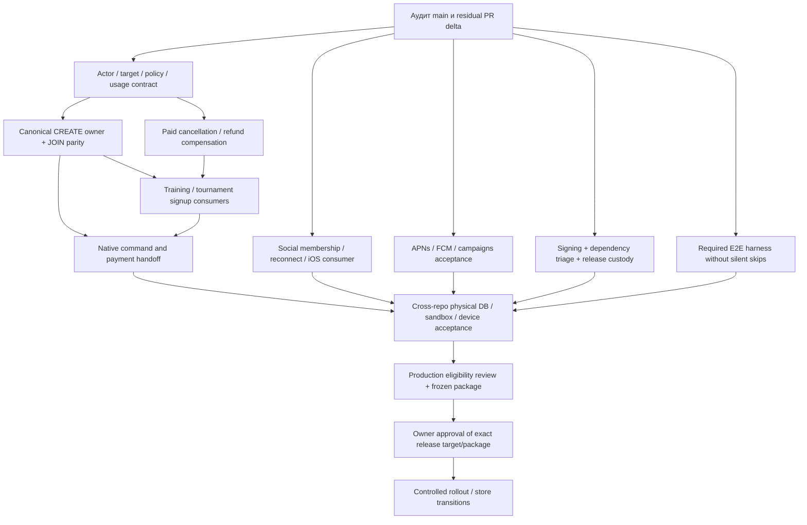

# LK2 R1 — зависимости и критический путь

Основа: [READINESS](R1-READINESS.md), [BLOCKERS](R1-BLOCKERS.md). Это последовательность закрытия фактических пробелов, без обещания даты release. Оценки времени невозможны до bounded task sizing и выделения provider/device test environment.

## Критический путь

Главная последовательность: **B02 → B03/B04 → B05/B06 → B10 → B01/B11 → owner decision**. Signing/B09 и social/push B07/B08 идут параллельно и должны завершиться до device acceptance; B12 high finding уже устранён на main; свежий dependency gate остаётся требованием финального source. Это граф зависимостей, не разрешение выполнить live шаги.

## Bounded task packets после аудита

| Пакет / роль             | Один результат                                                     | Repo / предполагаемая write ownership                                                       | До начала / acceptance                                                                         |
| ------------------------ | ------------------------------------------------------------------ | ------------------------------------------------------------------------------------------- | ---------------------------------------------------------------------------------------------- |
| A1 Release Auditor       | Зафиксировать baseline, остаточные PR deltas, evidence ledger      | Только семь `docs/release/R1-*.md`                                                          | Этот audit artifact; runtime implementation не принадлежит A                                   |
| B1 Core & Commerce       | Авторитетный policy/usage binding + reservation recheck            | LK2 subscription adapter; ph-admin policy/lifecycle — отдельный согласованный packet/branch | Сначала residual review #503; owner C не меняет эти refs; LK1 parity negative/concurrent tests |
| C1 Booking owner         | CREATE reserve/confirm/readback на существующем canonical writer   | LK Node-RED booked-operation receiver и его tests                                           | B1 contract freeze; совместимость существующего JOIN сохраняется                               |
| C2 Booking consumer      | LK2 завершает CREATE по authoritative receipt                      | LK2 game-create-commercial modules                                                          | C1 accepted contract; replay/response-loss/outbox tests                                        |
| B2 Commerce compensation | Paid LEAVE/CANCEL возвращает визит/деньги один раз                 | Canonical owner LK, затем отдельный LK2 consumer packet                                     | B1/C1; одна saga, terminal provider readback; provider writes отдельно                         |
| C3 Training              | Законченный training signup/cancel path                            | LK2 training API/consumer                                                                   | B1/B2; capacity/eligibility/recovery                                                           |
| C4 Tournaments           | Законченный tournament signup/cancel path                          | LK2 tournament API/consumer                                                                 | Та же owner contract; права organizer и participant                                            |
| D1 Social                | Все четыре chat contexts + station membership/reconnect acceptance | LK2 messaging/realtime/community modules                                                    | B/C владеют business event producers; D — membership projection/authorization                  |
| E1 Engagement            | Device tokens + scenario delivery проходят recovery acceptance     | LK2 notifications/worker/native push                                                        | F согласует capabilities; без массовой рассылки и real audiences                               |
| F1 Dependencies          | Устранить/квалифицировать current dependency gate failure          | Root dependency graph/lockfile                                                              | Единственный platform owner, full gate; отдельно от mobile signing packet                      |
| F2 Mobile release        | Review/adopt остаток #504, завершить iOS signed build contract     | Mobile build/workflow/signing docs                                                          | Не создавать ключи/секреты; реальные signing/store операции только owner-authorized            |
| F3 Native journeys       | Доступные native commercial/social screens                         | Mobile/native bridge и platform route gating                                                | B/C/D contract stable; не снимать allowlist до безопасного handoff                             |
| G1 Required acceptance   | Candidate-bound automated E2E matrix без silent skips              | Тестовые файлы; CI wiring согласуется с F                                                   | Сначала audited disposable fixture ownership; никаких live defaults                            |
| F4 Release custody       | Проверяемый package/target/backup/rollback plan                    | Существующие release tools/runbooks                                                         | Финальный source; никакого dispatch/deploy на этапе подготовки                                 |

Внутри каждого пакета один write owner, одна outcome branch и PR. Cross-repo изменения оформляются отдельными PR с явной contract dependency; нет общей ветки, смешивающей все домены. Одновременно не более четырёх task branches, только одна platform task меняет workflows/deploy/root dependencies. B1, F1, C1, G1 могут начинаться независимо после согласования общей contract surface; если G1 требует workflow изменения, их проводит F или ставит G1 в очередь.

## PR disposition и интеграция

Полная таблица открытых PR находится в READINESS. Перед использованием кандидата сравнить actual diff с новым main: title/checks не доказывают ни отсутствия, ни завершения функции. Record: adopt residual / superseded / independent / installed-baseline-only. Не закрывать и не сливать чужие PR автоматически.

Одна интеграционная партия объединяет 2–4 готовых совместимых head; общий integration owner разрешает конфликты один раз. Обязательные зависимости upstream owner → downstream consumer должны быть приняты прежде, чем включать consumer. Merge остаётся отдельной границей. Проверки сохраняются, пока source/dependencies/command/environment/inputs/acceptance target неизменны.

## Evidence handoff для каждой задачи

Передать commit/PR/head, touched contract, focused/full checks с результатами и skips, fixture/environment identity, provider-write count, known limitations, rollback/recovery state. Для terminal booking/payment нужен receipt/readback, а не только HTTP 200. Для mobile нужен build identity + physical-device outcome. G собирает результаты; A не повышает их уровень.

## Решения владельца, которые понадобятся до live acceptance

- Поддерживаемые payment/subscription modes, refund/late-cancel правила и authoritative timezone/usage semantics; текущую LK1 семантику нельзя незаметно менять.
- Production topology и один канонический deploy route; target, tenant/station scope, writers, rollback floor, RPO/RTO.
- Изолированные test accounts/devices и разрешённые provider sandbox operations/notification recipients.
- Apple/Google account owner, approved signing identities, privacy/deletion/store obligations.

Эти неизвестные не препятствуют завершению аудита и безопасной реализации локальных bounded tasks; они блокируют зависимые provider/production/store переходы.

## Выполненные первые пакеты и следующий переход

- B02 local guards: #503 `39feed0c`, combined CI `41202183068` success. F1 high dependency fix #508 уже merged в `14ebdca6`, main CI `41201792854` success. B12 high blocker закрыт; owner v2 и provider acceptance этим не приняты.
- Следующий коммерческий packet — exact owner contract LK1/ph-admin: binding decision/usageRef,
  admission/delegation/receipt schemas, stable retry identity, reserve/confirm/release/compensate.
  Существующие advisory quote v1 и 17-field receipt не являются этим контрактом.
- После owner implementation подключить dormant LK2 consumer и пройти physical DB/provider
  sandbox acceptance; затем CREATE, paid LEAVE/CANCEL и training/tournament consumers.
- Signing, social, push и required E2E infrastructure сохраняют параллельные dependency lanes;
  закрытие локальных guards не разрешает отключать production guards.

## Уточнение owner critical path после compensation audit

1. ph-admin #57 (`d5000a4d`) — strict release proof/replay prerequisite на существующем ledger; confirmation v1 и strict-off legacy contract сохранены.
2. ph-admin #58 (`cab33ce`) — four-client physical Mongo reserve/confirm/release, rollback и committed-response-loss/child replay. CI `41201269983` success, все четыре workflow green.
3. ph-admin #59 (`70d3820c`) — actor/tenant/operation/instance-scoped primary-majority readback, семь полей, без owner proof или business write. Новый physical TTL case CI `41204278865` success: lost response после provider-rejection commit → read-only recovery beyond TTL; provider writes=0, skipped=0. Все четыре workflow green.
4. LK #264 (`de95b8cc`) — opt-in signer, durable original rejection, fresh-TTL retry и post-TTL readback только уже завершённого CUP release. LOCAL 213 passed / 1 skip; CI `41204447158` success. Неприменённый release после TTL остаётся pending; timestamp не обновляется.
5. Принять exact compatible heads, затем отдельно разрешённые runtime configuration / sandbox acceptance. Общий secret/config предусмотрен; создание, установка и активация сейчас не разрешены.
6. Owner v2 policy/instance/target/usage binding и authoritative CREATE consumer остаются следующим коммерческим критическим путём; затем paid cancellation/signup/native journeys. Этот compensation slice их не заменяет.

Dependency order: **ph-admin #57 → #58 → #59 → LK #264**. Merge не включает strict mode.
До runtime acceptance проверить Node-RED crypto injection, согласованные closed flags и оставшиеся
local pre-write abort paths. Не снимать production guards; полного B02/B04 acceptance ещё нет.

Параллельные lanes: #509 ordinary iOS APNs source реализован, physical CI 6/6 passed в combined #511;
#510 unsigned native CI и full CI success, signing/device/store acceptance отдельно. После этих
пакетов B08/B09 остаются PARTIAL, B06/B07 и полный B10 не закрыты.

## Уточнение CREATE target и social contracts — 2026-10-31

B03: `games.games.station_id/court_id` — канонические LK2 UUID; importer хранит associations
`game_station/game_court` под `LK_LEGACY_SNAPSHOT`. Sanitized identifiers необратимы, raw aliases
не обязательны, а migration 0042 допускает несколько aliases. Первый попавшийся alias не является
доверенным Viva ID для записи. Следующий CREATE-specific adapter должен читать organizer draft и
revision из одной версии, разрешать однозначное server-owned write mapping и повторно проверять
room/studio у LK owner. Missing/ambiguous mapping означает отказ до POST, не `LIMIT 1`.

Текущий admission receiver принимает JOIN+USE_SUBSCRIPTION с уже существующим exercise. CREATE
admission route возвращает 503, transport reserve не сохраняет reservation в итоговом PENDING,
confirm не связан с orchestration. Ни #503, ни #264 не закрывают этот consumer. Не расширять JOIN
claims фиктивным exercise ID; нужен отдельный CREATE action/target binding к существующему split
preflight/attempt/recovery, без второго usage ledger. Provider mapping/write authority и sandbox
acceptance остаются зависимостями, production guards сохраняются.

B04: LK split leave уже имеет actor/organizer authorization, durable claim/retry/CAS и provider
cancellation/readback. Однако просмотренный daily-limit route освобождает локальную allowance,
а bridge к CUP canonical entitlement release отсутствует. Согласовать этот шаг с одним owner;
cleanup scheduler не считать actor-authorized CANCEL API автоматически.

B07: Android уже отображает directory/history UI, но native session policy не разрешает существующий
GET `/community-views/:uuid/chat`. Это отдельный узкий read-access fix с negative native policy tests.
Он не завершает writable chat: community endpoint только GET, generic message repository разрешает
DIRECT/GAME, canonical community/tournament-to-conversation binding не найден. iOS дополнительно
требует Swift/TS session validation и controller/UI. #330 не добавляет community sending; #453/#466
затрагивают Android policy для GAME JOIN, поэтому будущий read-access PR должен объявить порядок
интеграции. Нельзя обойти membership checks клиентским вызовом generic send.

## Текущие отдельные исходные пакеты

1. Source integration #511 (`ed3854c3`) объединяет ровно #503/#509/#510/#507 и test-only
   Linux process-state regression fix. Combined CI и unsigned iOS success. Merge и отдельный
   temporary delivery suppression cycle ещё не одобрены; source freeze не меняется новыми задачами.
2. CUP #60 (`730e3f4c`) поверх #59: read-only canonical preflight + exact reserve expectations;
   physical CI success. Следом LK managed JOIN v2 owner поверх #264 и отдельный LK2 consumer
   поверх #511. Общие operation ID и v1 wire сохраняются; managed/legacy определяется одним
   server selector, не отсутствием instance. До consumer activation нужен verified compatible owner.
3. Android community history #512 (`96723a30`) — самостоятельный green candidate. iOS existing
   DIRECT/GAME chats #513 (`7b2213a0`) — отдельный stacked candidate на #511; LOCAL passed,
   CI `41210366790` и unsigned `41210366803` success. После разрешённого merge #511 retarget последующих PR на main без добавления
   пятого head в исходную integration batch.
4. Станционные сообщества ждут material cardinality/membership choices и canonical mapping owner.
   Нельзя подменить их support-dialog rows или объединить LOCAL membership с LEGACY chat writes.
5. После JOIN v2 идут canonical CREATE, paid cancellation/compensation, training/tournament
   consumers и native journeys. Provider/device/signing/restore acceptance остаются обязательными,
   а exact live/package authority запрашивается лишь для подготовленного конкретного перехода.

## CREATE target prerequisite из текущего source

Raw `booking.studioId`/`roomId` есть до sanitizer в LegacyGames Mongo adapter, но importer
сохраняет raw/pseudonymous aliases с одинаковой ролью. Migration 0042 разрешает несколько
`LK_LEGACY_SNAPSHOT/game_station,game_court` aliases на один internal UUID. Поэтому reverse
выбор первого alias не может дать authority на provider CREATE. Текущий draft resolver не
связывает court со station и не возвращает exact provider location.

До CREATE admission нужен versioned canonical location producer и resolver с явной связью
public court → station и provider room → studio, tenant/organizer/draft revision checks и
отказом при missing/ambiguous/conflicting evidence. LK уже имеет authoritative room/studio GET
проверку и durable precreate CAS, но это не заменяет LK2 mapping. Provider exercise ID должен
появиться только из actual create/readback; синтетический ID недопустим. Пакет пока не реализован.
