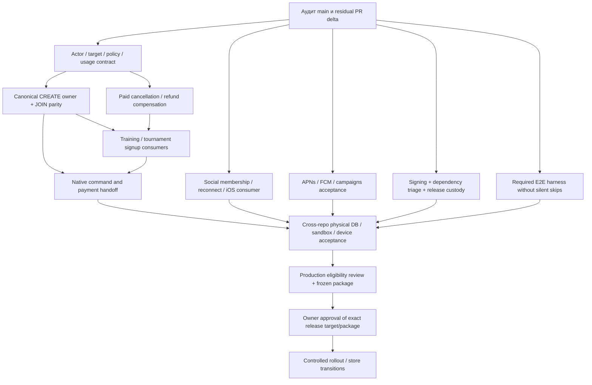

# LK2 R1 — зависимости и критический путь

Основа: [READINESS](R1-READINESS.md), [BLOCKERS](R1-BLOCKERS.md). Это последовательность закрытия фактических пробелов, без обещания даты release. Оценки времени невозможны до bounded task sizing и выделения provider/device test environment.

## Критический путь

Главная последовательность: **B02 → B03/B04 → B05/B06 → B10 → B01/B11 → owner decision**. Signing/B09 и social/push B07/B08 идут параллельно и должны завершиться до device acceptance; B12 блокирует финальный source gate. Это граф зависимостей, не разрешение выполнить live шаги.

## Bounded task packets после аудита

| Пакет / роль             | Один результат                                                     | Repo / предполагаемая write ownership                                                       | До начала / acceptance                                                                         |
| ------------------------ | ------------------------------------------------------------------ | ------------------------------------------------------------------------------------------- | ---------------------------------------------------------------------------------------------- |
| A1 Release Auditor       | Зафиксировать baseline, остаточные PR deltas, evidence ledger      | Только семь `docs/release/R1-*.md`                                                          | Этот audit artifact; runtime implementation не принадлежит A                                   |
| B1 Core & Commerce       | Авторитетный policy/usage binding + reservation recheck            | LK2 subscription adapter; ph-admin policy/lifecycle — отдельный согласованный packet/branch | Сначала residual review #503; owner C не меняет эти refs; LK1 parity negative/concurrent tests |
| C1 Booking owner         | CREATE reserve/confirm/readback на существующем canonical writer   | LK Node-RED booked-operation receiver и его tests                                           | B1 contract freeze; совместимость существующего JOIN сохраняется                               |
| C2 Booking consumer      | LK2 завершает CREATE по authoritative receipt                      | LK2 game-create-commercial modules                                                          | C1 accepted contract; replay/response-loss/outbox tests                                        |
| B2 Commerce compensation | Paid LEAVE/CANCEL возвращает визит/деньги один раз                 | Canonical owner LK, затем отдельный LK2 consumer packet                                     | B1/C1; одна saga, terminal provider readback; provider writes отдельно                         |
| C3 Training              | Законченный training signup/cancel path                            | LK2 training API/consumer                                                                   | B1/B2; capacity/eligibility/recovery                                                           |
| C4 Tournaments           | Законченный tournament signup/cancel path                          | LK2 tournament API/consumer                                                                 | Та же owner contract; права organizer и participant                                            |
| D1 Social                | Все четыре chat contexts + station membership/reconnect acceptance | LK2 messaging/realtime/community modules                                                    | B/C владеют business event producers; D — membership projection/authorization                  |
| E1 Engagement            | Device tokens + scenario delivery проходят recovery acceptance     | LK2 notifications/worker/native push                                                        | F согласует capabilities; без массовой рассылки и real audiences                               |
| F1 Dependencies          | Устранить/квалифицировать current dependency gate failure          | Root dependency graph/lockfile                                                              | Единственный platform owner, full gate; отдельно от mobile signing packet                      |
| F2 Mobile release        | Review/adopt остаток #504, завершить iOS signed build contract     | Mobile build/workflow/signing docs                                                          | Не создавать ключи/секреты; реальные signing/store операции только owner-authorized            |
| F3 Native journeys       | Доступные native commercial/social screens                         | Mobile/native bridge и platform route gating                                                | B/C/D contract stable; не снимать allowlist до безопасного handoff                             |
| G1 Required acceptance   | Candidate-bound automated E2E matrix без silent skips              | Тестовые файлы; CI wiring согласуется с F                                                   | Сначала audited disposable fixture ownership; никаких live defaults                            |
| F4 Release custody       | Проверяемый package/target/backup/rollback plan                    | Существующие release tools/runbooks                                                         | Финальный source; никакого dispatch/deploy на этапе подготовки                                 |

Внутри каждого пакета один write owner, одна outcome branch и PR. Cross-repo изменения оформляются отдельными PR с явной contract dependency; нет общей ветки, смешивающей все домены. Одновременно не более четырёх task branches, только одна platform task меняет workflows/deploy/root dependencies. B1, F1, C1, G1 могут начинаться независимо после согласования общей contract surface; если G1 требует workflow изменения, их проводит F или ставит G1 в очередь.

## PR disposition и интеграция

Полная таблица открытых PR находится в READINESS. Перед использованием кандидата сравнить actual diff с новым main: title/checks не доказывают ни отсутствия, ни завершения функции. Record: adopt residual / superseded / independent / installed-baseline-only. Не закрывать и не сливать чужие PR автоматически.

Одна интеграционная партия объединяет 2–4 готовых совместимых head; общий integration owner разрешает конфликты один раз. Обязательные зависимости upstream owner → downstream consumer должны быть приняты прежде, чем включать consumer. Merge остаётся отдельной границей. Проверки сохраняются, пока source/dependencies/command/environment/inputs/acceptance target неизменны.

## Evidence handoff для каждой задачи

Передать commit/PR/head, touched contract, focused/full checks с результатами и skips, fixture/environment identity, provider-write count, known limitations, rollback/recovery state. Для terminal booking/payment нужен receipt/readback, а не только HTTP 200. Для mobile нужен build identity + physical-device outcome. G собирает результаты; A не повышает их уровень.

## Решения владельца, которые понадобятся до live acceptance

- Поддерживаемые payment/subscription modes, refund/late-cancel правила и authoritative timezone/usage semantics; текущую LK1 семантику нельзя незаметно менять.
- Production topology и один канонический deploy route; target, tenant/station scope, writers, rollback floor, RPO/RTO.
- Изолированные test accounts/devices и разрешённые provider sandbox operations/notification recipients.
- Apple/Google account owner, approved signing identities, privacy/deletion/store obligations.

Эти неизвестные не препятствуют завершению аудита и безопасной реализации локальных bounded tasks; они блокируют зависимые provider/production/store переходы.

## Выполненные первые пакеты и следующий переход

- B02 local guards: #503 `d8af48b2`; F1 high dependency fix: #508 `18061aa8`.
  Ветки независимы, merge не выполнен. При интеграции сначала принять dependency fix и затем
  проверить combined source с #503; результаты раздельных веток не доказывают combined gate.
- Следующий коммерческий packet — exact owner contract LK1/ph-admin: binding decision/usageRef,
  admission/delegation/receipt schemas, stable retry identity, reserve/confirm/release/compensate.
  Существующие advisory quote v1 и 17-field receipt не являются этим контрактом.
- После owner implementation подключить dormant LK2 consumer и пройти physical DB/provider
  sandbox acceptance; затем CREATE, paid LEAVE/CANCEL и training/tournament consumers.
- Signing, social, push и required E2E infrastructure сохраняют параллельные dependency lanes;
  закрытие локальных guards не разрешает отключать production guards.

## Уточнение owner critical path после compensation audit

1. ph-admin #57 (`d5000a4d`) — release verification/replay prerequisite на существующем canonical
   ledger; отдельная ветка, без новой коллекции, миграции или изменения v1 confirmation.
2. LK signer реализован в Draft #264 (`453e8459`): exact confirmation/cancellation и ограниченный
   definite booking rejection, negative/retry tests. Следующий bounded packet — provenance для
   split/local abort и physical ledger/recovery harness. Общий secret/config уже предусмотрен контрактом,
   но создание/установка/смена секрета не разрешены текущим запросом.
3. Связать reserve/confirm/release с точными policy/instance/target/usage refs будущего owner v2;
   пройти физический ledger/response-loss acceptance и отдельно provider sandbox readback.
4. После принятия owner contract завершить LK2 consumers. Не включать strict mode до готовности
   producer и не снимать production guards. #57 не зависит от merge #503/#508 на уровне кода,
   но не заменяет их и не доказывает совместный acceptance.

Owner integration order: ph-admin #57 receiver → LK #264 producer → разрешённая отдельно
runtime configuration / sandbox acceptance. Merge любого из этих PR не включает strict mode.
До runtime acceptance проверить Node-RED crypto injection, согласованную конфигурацию receiver/producer
и оставшиеся abort paths. Полный B02/B04 exit criterion не закрыт.
